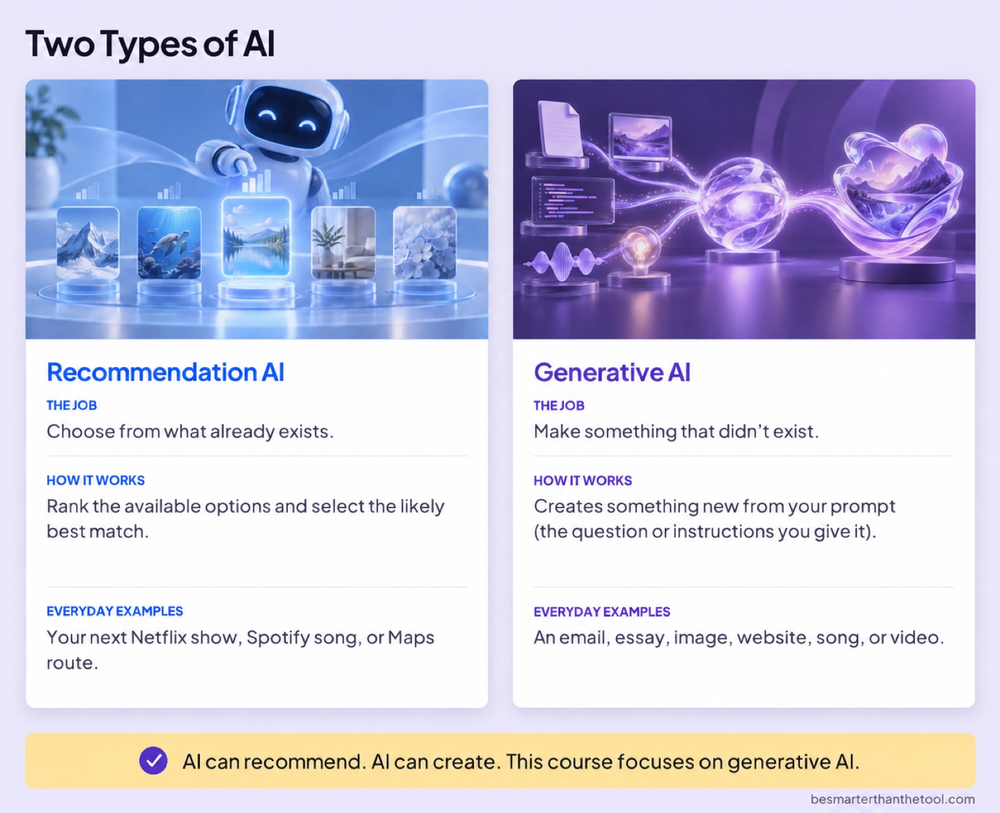

# What Is AI?

### Two Types of AI

**Image file:** `what-is-ai-types.jpg`

**Teaching content:**

Then there is generative AI.

Its job is to make something that didn’t exist.

Generative AI creates something new from your prompt—the question or instructions you give it.

This can result in an email, essay, image, website, song, or video.

AI can recommend. AI can create. This course focuses on generative AI.

## Closing Message

You’ve got a tool that can help.

Start with something you want to do.
