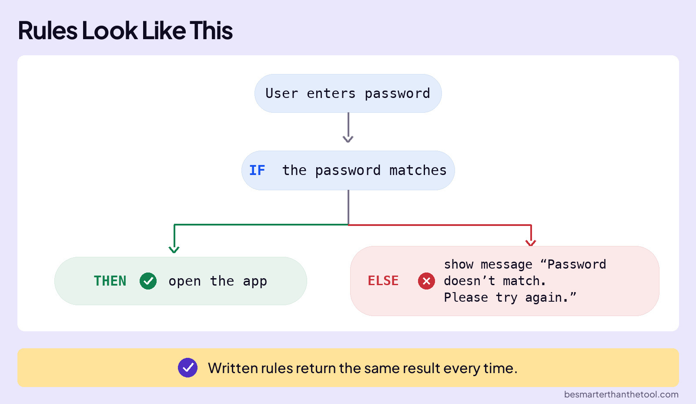
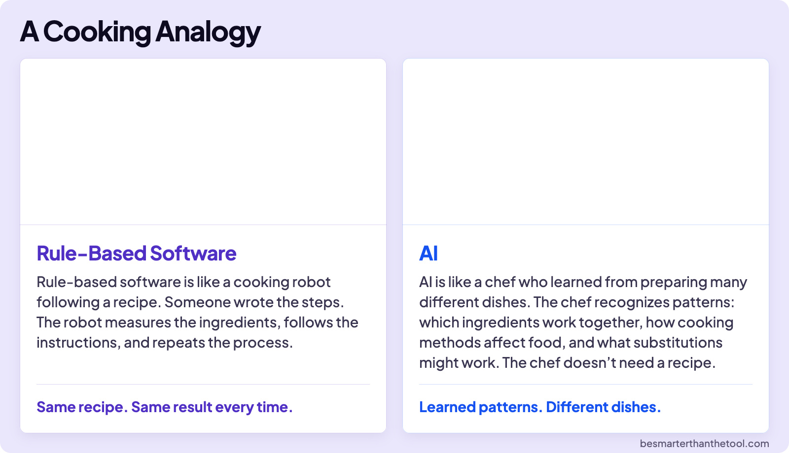
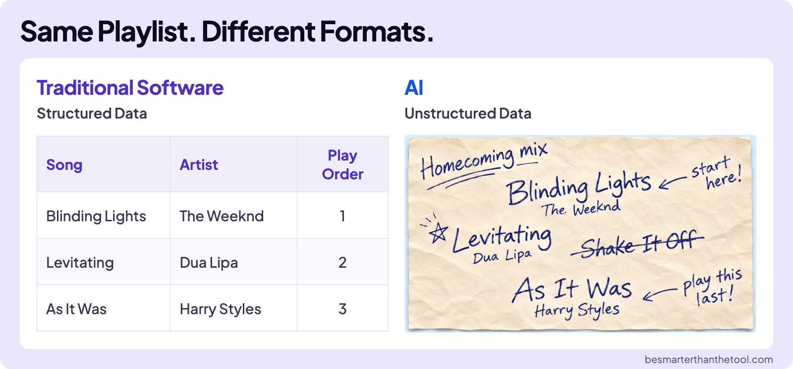
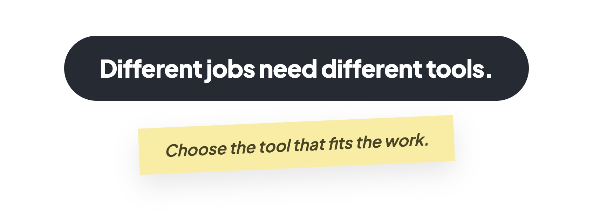

## START SMARTER

# AI is Different

Today’s AI behaves differently from traditional software. If you expect it to act like the software you’re used to, its behavior can be confusing.

Two differences help explain why. First, AI learns patterns from examples rather than relying only on rules written by programmers. Second, it can work with “unstructured data,” such as everyday language, images, and audio, with far greater flexibility than traditional software. These differences make AI more capable in many situations, but also less predictable.

## Rules-Based Software

You’re signing into Spotify. You enter the wrong password. Should the app open because you were close? Or because your spelling was creative?

No. You want it to follow a rule: **let me in only if the password matches.**

Non-AI software is based on instructions like this that people wrote. A calculator follows instructions for mathematical operations. A spreadsheet applies formulas to the information you enter.

### Board 1: Rules Look Like This

**Image file:** `ai-is-different-rules.jpg`

**Teaching content:**

Rules look like this. A user enters a password. If the password matches, then the app opens. Otherwise, the app shows “Password doesn’t match. Please try again.”

Written rules return the same result every time.

## Rules vs. Patterns

Traditional software follows instructions written by programmers.

AI learns patterns from examples during training and uses those patterns to answer you.

People still write the code that trains and runs AI, but they don’t write each answer.

### Board 2: A Cooking Analogy

**Image file:** `ai-is-different-cooking-analogy-faceless.jpg`

**Teaching content:**

Here’s a cooking analogy. Rule-based software is like a cooking robot following a recipe. Someone wrote the steps. The robot measures the ingredients, follows the instructions, and repeats the process.

Same recipe. Same result every time.

AI is like a chef who learned from preparing many different dishes. The chef recognizes patterns: which ingredients work together, how cooking methods affect food, and what substitutions might work.

The chef doesn’t need a recipe.

Learned patterns. Different dishes.

## Structured vs. Unstructured Data

Traditional software usually needs information entered in a specific structure.

Think of a spreadsheet, with rows and columns. That’s **structured data**.

AI can work with **unstructured data**. You don’t need to organize it into specific rows and columns. Give it what you have, and it can help make sense of it.

Here’s the same short playlist in both formats. Notice the difference?

### Board 3: Same Playlist. Different Formats.

**Image file:** `ai-is-different-playlist-formats.jpg`

**Teaching content:**

On the left, traditional software uses structured data. The table has Song, Artist, and Play Order columns: Blinding Lights by The Weeknd is first, Levitating by Dua Lipa is second, and As It Was by Harry Styles is third.

On the right, AI works with unstructured data. Handwritten homecoming notes contain the same songs and artists, with an arrow saying “start here!” beside Blinding Lights and “play this last!” beside As It Was. Shake It Off is crossed out and does not appear in the table. The information is not arranged into consistent fields.

## How AI Interprets the Notes

AI can do this because, during training, it learned patterns in handwriting, language, and visual clues like arrows and crossed-out words.

It uses those patterns to help interpret your notes, even when they aren’t neatly organized.

## The downside

Using learned patterns makes AI flexible, but its response can be harder to predict and inspect than a written rule like the password check.

It might miss a crossed-out song.

It might look great, but still have mistakes.

## Closing Message

**Image file:** `ai-is-different-close.jpg`

Different jobs need different tools.

Choose the tool that fits the work.
