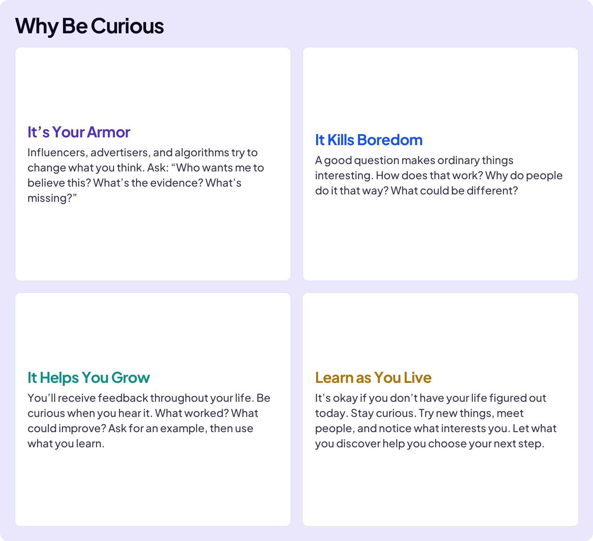
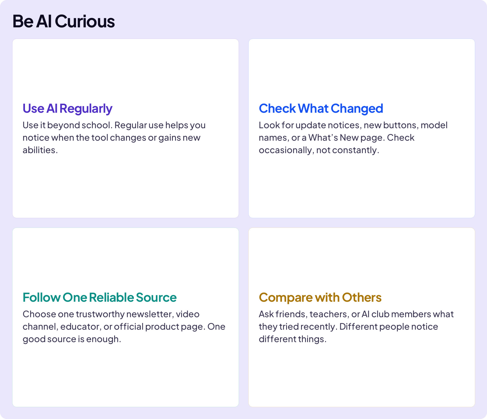
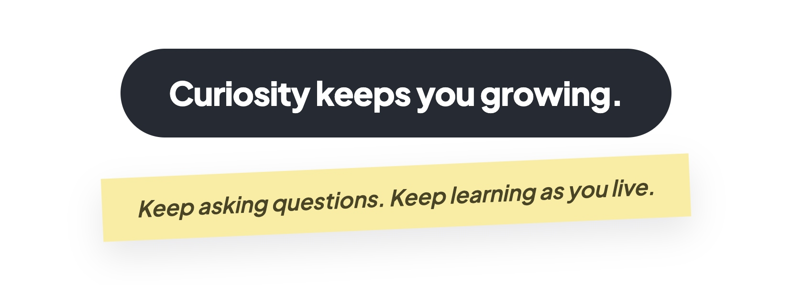

## BUILD YOUR SKILLS

# Curiosity

Imagine you are captain of your school’s basketball team. Your team has a play that worked all season. Then another team learns how to stop it.

Before you find a better play, you need to **be curious**.

What are they doing differently? Where is there an opening? What could you learn by watching the play again?

Curiosity reaches far beyond basketball. Taking an interest, asking questions, and exploring possibilities helps you keep learning throughout your life.

There is always more to discover.

### Board 1: Why Be Curious

**Image file:** `be-curious-why-faceless.jpg`

**Teaching content:**

Why be curious?

**It’s Your Armor**

Influencers, advertisers, and algorithms try to change what you think. Ask: “Who wants me to believe this? What’s the evidence? What’s missing?”

**It Kills Boredom**

A good question makes ordinary things interesting. How does that work? Why do people do it that way? What could be different?

**It Helps You Grow**

You’ll receive feedback throughout your life. Be curious when you hear it. What worked? What could improve? Ask for an example, then use what you learn.

**Learn as You Live**

It’s okay if you don’t have your life figured out today. Stay curious. Try new things, meet people, and notice what interests you. Let what you discover help you choose your next step.

## AS AI CHANGES

AI changes quickly. New models, tools, and ways of working keep appearing. You do not need to chase every new feature. Stay curious about changes that could matter to you.

### Board 2: Be AI Curious

**Image file:** `be-curious-ai-faceless.jpg`

**Teaching content:**

Be AI curious.

**Use AI Regularly**

Use it beyond school. Regular use helps you notice when the tool changes or gains new abilities.

**Check What Changed**

Look for update notices, new buttons, model names, or a What’s New page. Check occasionally, not constantly.

**Follow One Reliable Source**

Choose one trustworthy newsletter, video channel, educator, or official product page. One good source is enough.

**Compare with Others**

Ask friends, teachers, or AI club members what they tried recently. Different people notice different things.

### Board 3: Close

**Image file:** `curious-and-flexible-close.jpg`

## Closing Message

Curiosity keeps you growing.

Keep asking questions. Keep learning as you live.
