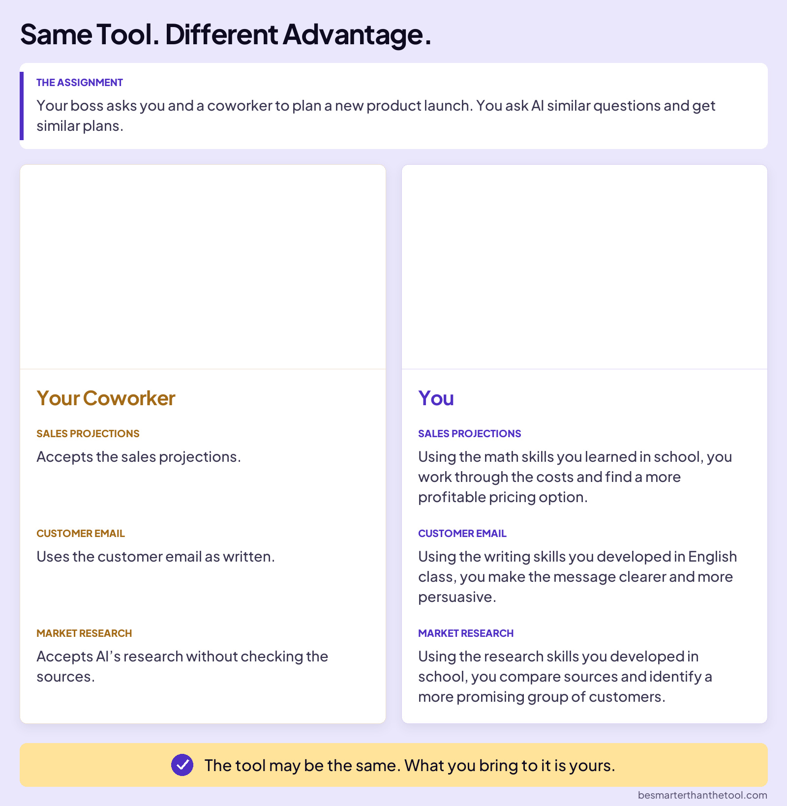
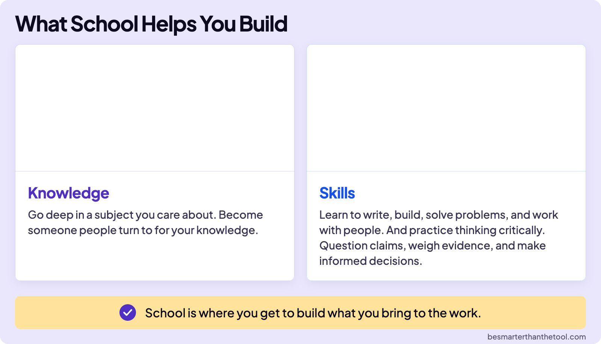
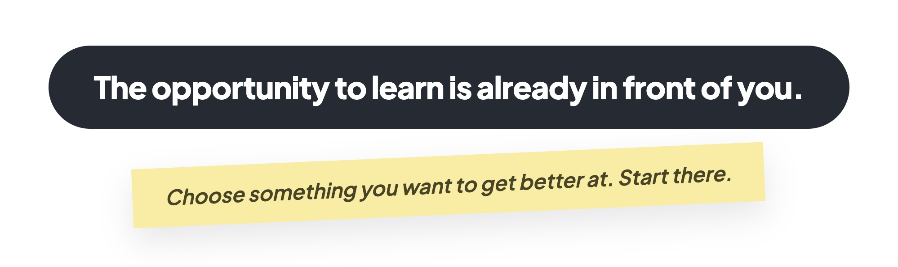

## START SMARTER

# Does School Matter?

A lot of people your age are quietly asking the same thing. If AI can answer anything, do you even need school anymore? Why sit through years of classes when the tool spits out the answer in seconds?

Think about it this way.

Fast forward a few years. You’ve landed your dream job, and AI sits right next to you all day, cranking out drafts, code, and plans. Your coworker at the next desk is doing the same. You each have the same job, using the same AI.

Then your boss gives you an assignment.

### Board 1: Same Tool. Different Advantage.

**Image file:** `does-school-matter-product-launch-faceless.jpg`

**Teaching content:**

Same tool. Different advantage.

The assignment: your boss asks you and a coworker to plan a new product launch. You ask AI similar questions and get similar plans.

Sales projections. Your coworker accepts the sales projections.

Using the math skills you learned in school, you work through the costs and find a more profitable pricing option.

Customer email. Your coworker uses the customer email as written.

Using the writing skills you developed in English class, you make the message clearer and more persuasive.

Market research. Your coworker accepts AI’s research without checking the sources.

Using the research skills you developed in school, you compare sources and identify a more promising group of customers.

The tool may be the same. What you bring to it is yours.

## What You Bring

You started with similar AI answers. You ended with different work.

The difference was the knowledge and skills you brought to the assignment. You knew what to question, what to improve, and what else to investigate.

But those abilities didn’t appear when you got the job. You started building them in school: writing papers taught you to organize ideas and make a convincing point, working through math problems helped you understand how the numbers fit together, and researching subjects taught you to weigh evidence before reaching a conclusion.

### Board 2: What School Helps You Build

**Image file:** `what-school-helps-you-build-faceless.jpg`

**Teaching content:**

Here’s what school helps you build.

Knowledge: go deep in a subject you care about. Become someone people turn to for your knowledge.

Skills: learn to write, build, solve problems, and work with people. And practice thinking critically. Question claims, weigh evidence, and make informed decisions.

School is where you get to build what you bring to the work.

## Be Smarter Than the Tool

Find something that interests you and go deep. Whatever tools come next, that knowledge and those skills are yours. That’s what it means to Be Smarter Than the Tool.

### Close

**Image file:** `does-school-matter-close.jpg`

## Closing Message

The opportunity to learn is already in front of you.

Choose something you want to get better at. Start there.
