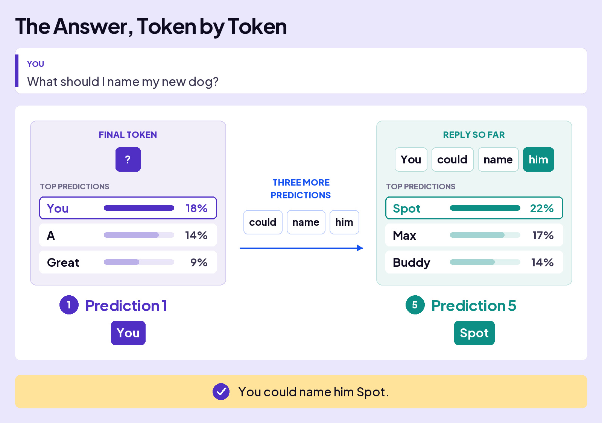

## UNDERSTAND AI

# How AI Answers

When you ask AI a question, it first works out what your words mean together. Then it faces a new problem: how does it begin an answer?

Let’s give AI a simple question and watch how it builds an answer, one token at a time. We’ll show words as single tokens to make the example easier to follow.

### Board 1: Before the Answer Begins

**Image file:** `how-ai-answers-before-answer-begins.jpg`

**Teaching content:**

You ask: “What should I name my new dog?”

Before the answer begins, the question goes through four steps you have already seen.

Step 1, Tokens: AI breaks the question into pieces.

Step 2, Positions: AI marks where each piece belongs.

Step 3, Starting Vectors: AI turns each token into numbers that carry its starting meaning.

Step 4, Through Layers: attention and transformation work together to update the numbers.

Here’s an important point about the layers. **Each token’s vector is updated using information from the tokens before it.**

Let’s follow the last token in “What should I name my new dog?” It begins with a starting vector representing a question mark. As it passes through the layers, those numbers change to reflect your question about naming a dog. After running through all the layers, the question mark’s vector reflects the context of your specific question.

Let’s see what this looks like. Both questions below end with the same token: a question mark. But the question mark’s vector has different numbers in each case because it reflects a different question.

### Board 2: Same Token, Different Context

**Image file:** `how-ai-answers-same-token-context.jpg`

**Teaching content:**

In “What should I name my new dog?” the question mark’s vector reflects naming a dog.

In “What should I cook for dinner?” the question mark’s vector reflects choosing a meal.

## WHY IS THIS IMPORTANT

AI uses the final token’s updated vector to predict the first token of its answer. It adds the chosen token to the context, then predicts the next one. That’s how AI builds a response: one token at a time, using your question and the answer so far.

## Starting the Answer

AI is ready to answer your question. It uses the final token’s updated numbers to calculate a probability for every token in its vocabulary.

Now watch the loop. AI selects a token, adds it to the reply, and uses the growing context to predict again.

### Board 3: The Answer, Token by Token

**Image file:** `how-ai-answers-token-by-token.jpg`

**Teaching content:**

Here is the answer, token by token.

You ask: “What should I name my new dog?”

Prediction 1. The reply has not started, so the final token is the question mark. The top predictions are You at 18 percent, A at 14 percent, and Great at 9 percent. AI selects You in this example.

Three more predictions add could, name, and him.

Prediction 5. The reply so far is You could name him, so the final token is him. The top predictions are Spot at 22 percent, Max at 17 percent, and Buddy at 14 percent. AI selects Spot in this example.

The completed answer is a full sentence.

You could name him Spot.

## What Can Fit Next

You asked for a dog name, but AI began with You, a possible start to a reply.

Each added token changes what can fit next.

After You could name him, a dog name becomes a likely continuation.

AI keeps predicting tokens until it produces a special token that signals the answer is finished.

## Inference

AI repeats the same loop: predict a next token, select it, and add it to the answer. Each addition becomes part of the context for the next prediction. This process of generating an answer is called inference.

## Closing Message

Every answer is built one token at a time.

The whole run is called inference.
