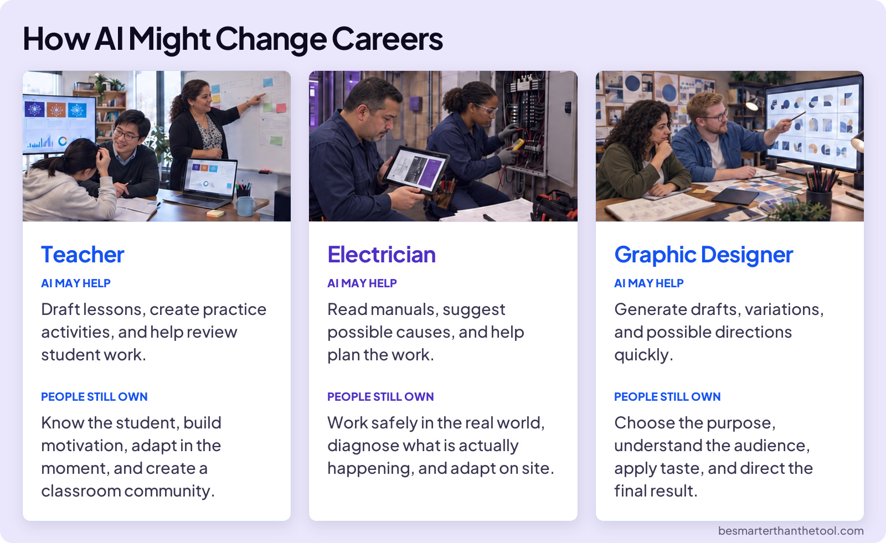
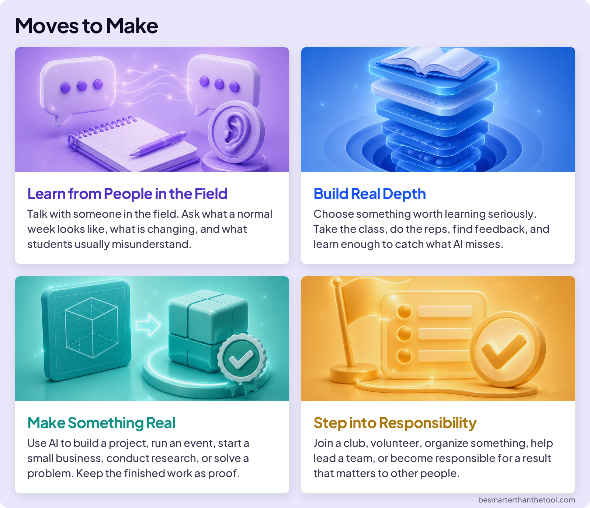
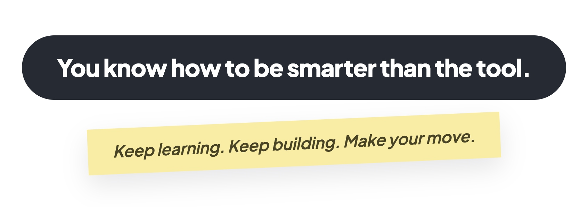

## BUILD YOUR SKILLS

# Make Your Move

Imagine you started a basketball team with friends. You learned the fundamentals, practiced regularly, and became better players. Then someone asks, “What’s next? Are we joining a league? Are we actually going to play?”

That is where you are now with AI. You have learned the fundamentals and built important skills. Now it is time to decide what you will do with them.

## AI AND YOUR FUTURE CAREER

If you’re thinking about how AI might change careers, you’re not alone. But remember: jobs are made up of many different tasks, and AI will not affect every task in the same way.

### Board 1: How AI Might Change Careers

**Image file:** `make-your-move-careers.jpg`

**Teaching content:**

Teacher. AI may help draft lessons, create practice activities, and help review student work. People still own knowing the student, building motivation, adapting in the moment, and creating a classroom community.

Electrician. AI may help read manuals, suggest possible causes, and help plan the work. People still own working safely in the real world, diagnosing what is actually happening, and adapting on site.

Graphic designer. AI may help generate drafts, variations, and possible directions quickly. People still own choosing the purpose, understanding the audience, applying taste, and directing the final result.

You’ve practiced working with people, using judgment, solving problems, and staying flexible. Now choose somewhere to put those skills to work.

## FOUR MOVES TO MAKE

You do not need to choose your entire future today. These four moves work whether you already have a career in mind or are still exploring.

### Board 2: Moves to Make

**Image file:** `make-your-move-actions.jpg`

**Teaching content:**

Learn from people in the field: talk with someone in the field. Ask what a normal week looks like, what is changing, and what students usually misunderstand.

Build real depth: choose something worth learning seriously. Take the class, do the reps, find feedback, and learn enough to catch what AI misses.

Make something real: use AI to build a project, run an event, start a small business, conduct research, or solve a problem. Keep the finished work as proof.

Step into responsibility: join a club, volunteer, organize something, help lead a team, or become responsible for a result that matters to other people.

### Board 3: Close

**Image file:** `make-your-move-close.jpg`

## Closing Message

You know how to be smarter than the tool.

Keep learning. Keep building. Make your move.
