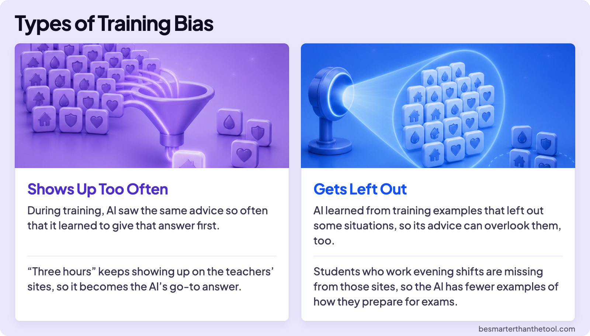
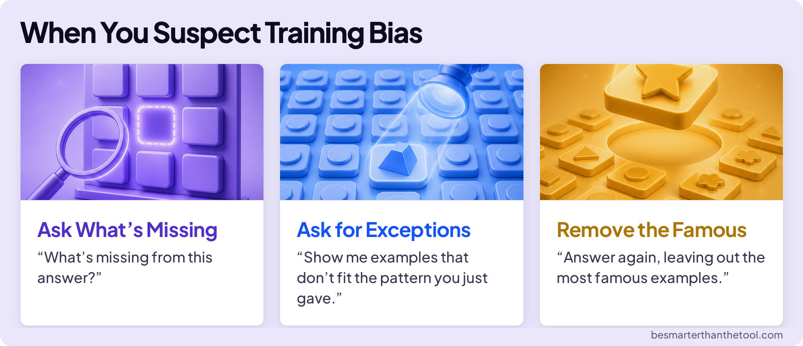

## AVOID TRAPS

# Training Bias

You ask three people, “How much should I study for my exam?”

- Your science teacher says, “Three hours.”
- Your mom says, “30 minutes, because you have to work tonight.”
- Your best friend says, “Studying is overrated.”

How could three people you trust give you such different answers? Each brings their own experience to the question, and that can bias the advice they give you.

## Training Bias

You heard three perspectives. Imagine an AI learned from only one.

In this example, it gets all its study advice from websites written by science teachers. On those sites, a common tip is to study for three hours before a big test. You ask, “How much should I study for my exam?” The AI tells you, based on what it learned, “Three hours.”

That’s training bias. The AI learned from sources that gave it only part of the picture, and that shaped its answer.

### Board 1: Types of Training Bias

**Image file:** `training-bias-study-time.jpg`

**Teaching content:**

Here are two types of training bias.

**Shows Up Too Often.** During training, AI saw the same advice so often that it learned to give that answer first. “Three hours” keeps showing up on the teachers’ sites, so it becomes the AI’s go-to answer.

**Gets Left Out.** AI learned from training examples that left out some situations, so its advice can overlook them, too. Students who work evening shifts are missing from those sites, so the AI has fewer examples of how they prepare for exams.

**Scene (your own drawing, no board):**

## How to Spot Training Bias

Training bias can be tough to spot. Often, your first clue is that an AI answer just doesn’t feel right.

Say you ask AI for examples of successful entrepreneurs. It lists ten tech founders, and you think, “Wait, why are all ten in tech?” So you ask, “Who else would make this list if we looked outside tech?”

The list tells you which industry showed up. You’d need more evidence to know why.

### Board 2: When You Suspect Training Bias

**Image file:** `training-bias-when-you-suspect.jpg`

**Required spoken prompts — say each line exactly as written:**

1. **Ask What’s Missing.** “What’s missing from this answer?”
2. **Ask for Exceptions.** “Show me examples that don’t fit the pattern you just gave.”
3. **Remove the Famous.** “Answer again, leaving out the most famous examples.”

## Closing Message

AI learns from its training data.

Bias in the data can shape the answer.
