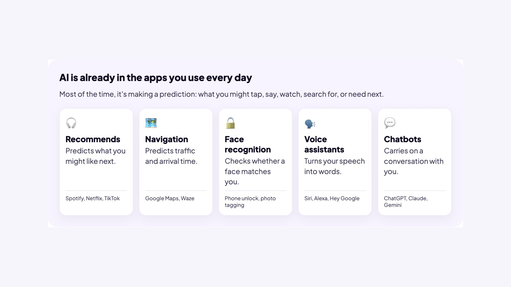
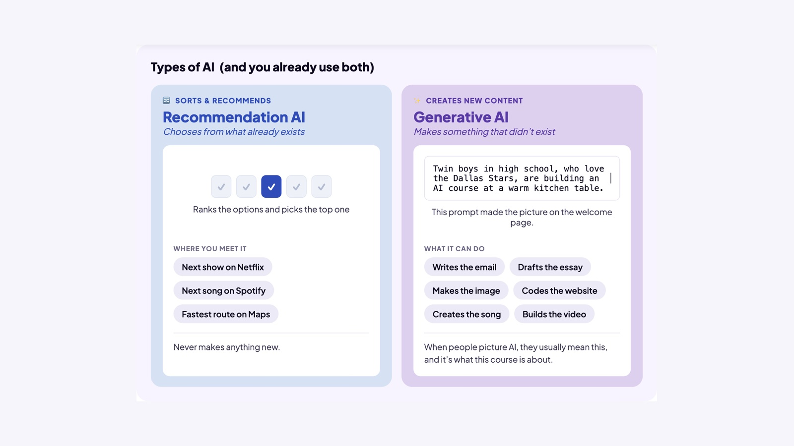

## START SMARTER

# What Is AI?

You need to start your next history project, but you haven’t picked a topic.

Ask your desk, “Give me 10 ideas for my next history project.”

Nothing. It’s a desk.

Ask a friend, and they can help you brainstorm. Ask AI, and it can give you a list in seconds.

### Board 1: Ask the Desk. Ask AI.

**Image file:** `what-is-ai-ask-the-desk-faceless.jpg`

**Teaching content:**

Ask the desk. Ask AI.

You ask the desk, “Give me 10 ideas for my history project.” The desk gives you nothing.

You ask AI, “Give me 10 ideas for my history project.”

AI gives you ten history project ideas: Ancient Egypt, the printing press, the Silk Road, the moon landing, the Roman Empire, the Industrial Revolution, the civil rights movement, the history of voting, the invention of flight, and the Berlin Wall.

AI is software built to do things that used to take a human brain.

## What AI Is

Understand a question. Summarize information. Translate a conversation. Suggest ideas for a history project.

That doesn’t mean it thinks like your friend, or that all 10 ideas will be good. But you now have a tool that can help with tasks that once needed a person.

## AI IS EVERYWHERE

AI isn’t something you go visit. It’s already in the apps on your phone, the search results you read, and the tools your first job will hand you on day one. It feels like AI went from sci-fi to normal in a few years.

Most of what it does today, it will do better tomorrow.

### Board 2: Where AI Already Lives

**Image file:** `why-learn-ai-everyday.jpg`

**Teaching content:**

Here’s where AI already lives: five places you use.

AI recommends things by predicting what you might like next. You’ve seen it in Spotify, Netflix, and TikTok.

Navigation predicts traffic and arrival time. You’ve seen it in Google Maps and Waze.

Face recognition checks whether a face matches you. You’ve seen it in phone unlock and photo tagging.

Voice assistants turn your speech into words. You’ve seen it in Siri, Alexa, and Hey Google.

Chatbots carry on a conversation with you. You’ve seen it in ChatGPT, Claude, and Gemini.

AI was already part of your day before chatbots arrived.

## TYPES OF AI

Different AI systems do different jobs. Let’s look at two types you already use.

### Board 3: Two Types of AI

**Image file:** `what-is-ai-types.jpg`

**Teaching content:**

Here are two types of AI you already use.

Recommendation AI. The job: choose from what already exists.

How it works: rank the available options and select the likely best match.

Everyday examples: your next Netflix show, Spotify song, or Maps route.

Generative AI. The job: make something that didn’t exist.

How it works: creates something new from your prompt (the question or instructions you give it).

Everyday examples: an email, essay, image, website, song, or video.

AI can recommend. AI can create. This course focuses on generative AI.

## Closing Message

You’ve got a tool that can help.

Start with something you want to do.
