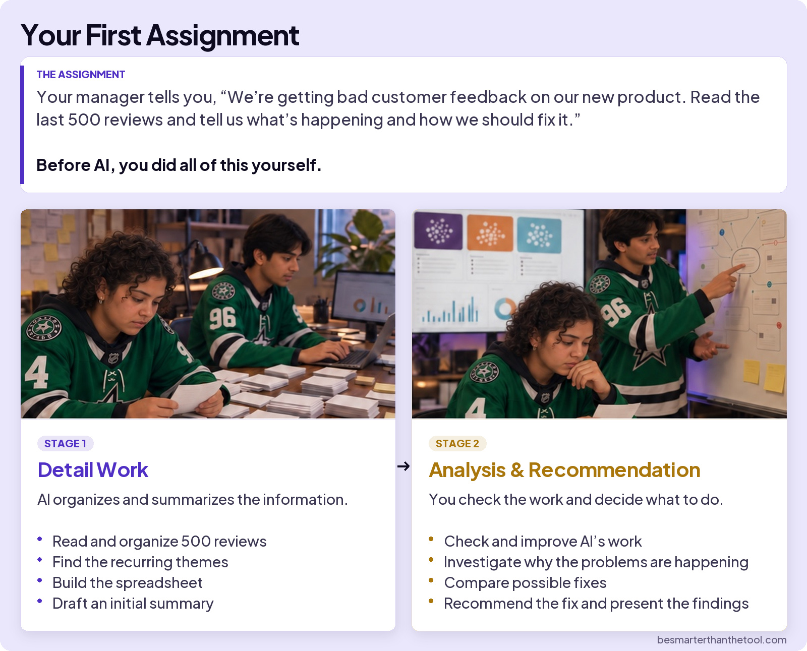

## EMBRACE THE FUTURE

# Work Changes

Before you know it, you’ll be finished with school and starting your career. How is AI changing work? Glad you asked.

Familiar job titles will still be around, like entrepreneur, teacher, and lawyer. But what those jobs look like is already changing, including what people do each day.

You already know AI is best at specific things, and that’s where you’ll use it in your job. What sets you apart? It’s what you already know. Now put those ideas together on your first assignment at work.

## Your First Assignment

Here are the steps in your first assignment. AI can give you more time for the interesting stuff.

### Board 1: Your First Assignment

**Image file:** `../course-assets/work-changes/work-changes-assignment-short.jpg`

**Teaching content:**

Your first assignment.

Your manager tells you, “We’re getting bad customer feedback on our new product. Read the last 500 reviews and tell us what’s happening and how we should fix it.”

**Before AI, you did all of this yourself.**

**Stage 1: Detail Work.** AI organizes and summarizes the information. Read and organize 500 reviews, find the recurring themes, build the spreadsheet, and draft an initial summary.

**Stage 2: Analysis & Recommendation.** You check the work and decide what to do. Check and improve AI’s work, investigate why the problems are happening, compare possible fixes, recommend the fix and present the findings.

## Do You See the Point?

With AI’s help, your week begins with the analysis and recommendation. That means less time in spreadsheets and more time thinking. Checking and improving AI’s work takes what you already know.

## The Concepts

You just saw two ways to use AI at work: automate and augment.

### Board 2: Two Ways AI Changes the Work

**Image file:** `work-changes-automation-and-augmentation.jpg`

**Teaching content:**

Two ways AI changes the work.

Automate. AI takes over a step. It sorted the reviews, grouped the ideas, and created the first summary.

Augment. AI helps a person do more. AI helped you explore more explanations, compare more options, and improve your recommendation.

The work still has your name on it. You own the outcome.

## The Part That Matters

AI is already changing some entry-level work. Basic research, starter code, and simple analysis often helped new graduates learn a profession. AI can now handle or assist with some of that work.

AI can make you productive before it makes you knowledgeable.

That creates a strange problem. You might be asked to check sophisticated work before you’ve had the chance to learn it.

You already know what you must do. Learn. And learn more. And you’re in the best place in the world to do it: school.

## Closing Message

AI is changing the work you’ll do.

Now it’s on you to LEARN.

## Lab: Turn Reviews into Recommendations

Use the [100 course reviews](../packets/course-reviews.txt) to investigate the complaints, check AI’s claims against the original reviews, look for rare issues, and choose a recommendation before AI prepares the presentation.

### Record Your Decision

After choosing your recommendation, write these yourself, in your own words. One sentence each is enough. Point to the reviews you checked and explain your choice.

- I checked ___ against review(s) ___.
- I changed or rejected ___ because ___.
- I chose ___ because ___.

Your notes save in this browser. Copy them into your presentation if you want to keep or share them.
